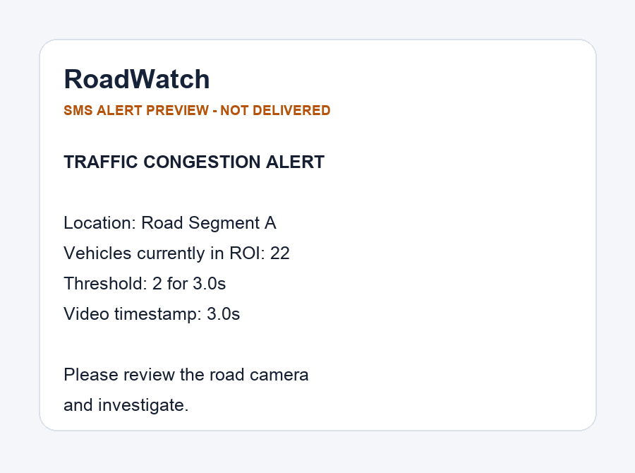

# RoadWatch — Vehicle Counting & Sustained Traffic Congestion Alerts

<!-- ROADWATCH_SHOWCASE_START -->

## Demo — Input to Output

RoadWatch processes recorded traffic footage using YOLOv3 and OpenCV.
It detects, classifies, and tracks vehicles, counts unique line crossings,
and monitors sustained road occupancy to identify potential congestion.

### Input and Annotated Output

| Original traffic footage | Processed vehicle detection |
| --- | --- |
| `14828714_1080_1920_30fps.mp4` — original traffic footage |  |

### Live Vehicle Detection and Counting

The following **10-second GIF** demonstrates annotated video output,
class-aware bounding boxes, vehicle tracking, and traffic counters.

<p align="center">
  
</p>

**Vehicle colors:** Blue = Car, Purple = Motorcycle,
Orange = Bus, Green = Truck, Yellow = Counted after line crossing.

### Congestion Detection

RoadWatch monitors the number of vehicles simultaneously present
inside a configured region of interest (ROI). If the occupancy
threshold remains exceeded for the configured duration,
a potential congestion event is recorded.

<p align="center">
  
</p>

### Automated Twilio SMS Alert

When a congestion event is detected, RoadWatch generates an
SMS notification containing the road name, vehicle occupancy,
threshold, and video timestamp.

<p align="center">
  
</p>

**Integration status:** The application successfully submitted an
SMS request to Twilio. Actual carrier delivery was blocked by
US A2P 10DLC registration requirements (Twilio error 30034).
The image above is an illustrative alert preview, not proof
of delivery to a mobile device.

### Technical Details

- **Detection:** YOLOv3 with OpenCV DNN
- **Tracking:** Vehicle identity association and class-aware tracking
- **Counting:** Unique tracked vehicles crossing a virtual line
- **Congestion:** Sustained occupancy within a configurable ROI
- **Backend:** FastAPI
- **Notifications:** Twilio SMS integration
- **Evidence:** Annotated video, event screenshots, CSV, and JSON reports

<!-- ROADWATCH_SHOWCASE_END -->


A local, browser-based traffic-video analytics prototype. It extends the original YOLOv3 / OpenCV vehicle-counting code into a complete **recorded video → detect & classify → track → two independent counts → duration-based congestion event → Twilio SMS** pipeline.

**Status:** end-to-end software flow implemented and offline-tested with synthetic detections. **Actual YOLOv3 inference on your road footage and delivery to a real phone are not yet verified.** These require a local download of the pretrained model, a real video, and optional personal Twilio credentials. The app does **not** retrain YOLOv3 or claim to measure vehicle speed.

## 1. Two counts, two meanings

| Metric | What it answers | How it works |
| --- | --- | --- |
| **Cumulative line crossings (traffic throughput)** | How many unique tracked vehicles crossed a virtual horizontal line in this video? | Tracks are counted once on a stable side-to-side line transition. Tracks retain class labels (car, motorcycle, bus, truck). |
| **Concurrent ROI occupancy (traffic density proxy)** | How many vehicles can the camera see **right now** within a chosen road region? | Counts the currently visible vehicle tracks whose centers are inside the ROI on each frame. |

**Congestion rule:** occupancy ≥ `occupancy_threshold` **continuously** for at least `persistence_seconds` of *video time*. The default is **25 vehicles for 180 seconds**. This produces a **potential congestion** event and one SMS alert (or preview). An occupancy decline lasting `recovery_seconds` ends that event. The same 25 vehicle IDs are **not** required to remain in view throughout the window; only the current number present matters.

This approach does not guarantee that traffic is stopped. A full road with fast-moving vehicles might also sustain high occupancy; motion/speed-based evidence would improve accuracy. This system is intended for human review, not an autonomous enforcement decision.

## 2. System overview

```text
Traffic video (.mp4 / .avi / .mov / .mkv)
    |
    v
OpenCV video decoder --> seconds = frame index / source FPS
    |
    v
OpenCV DNN + pretrained Darknet YOLOv3 (COCO)
    |
    +--> car / motorcycle / bus / truck detections
    |
    v
Class-aware, nearest-centroid vehicle tracker
    |
    +--> A: virtual-line crossings by unique track ID [flow]
    |
    +--> B: visible tracks inside ROI             [occupancy]
    |                                                  |
    |                             threshold + continuous duration
    |                                                  |
    |                             CONGESTION_STARTED / CLEARED
    |                                                  |
    |                             SMS preview / Twilio opt-in send
    v
Annotated MP4 + event JPGs + counts CSV + JSON evidence
    |
    v
Local FastAPI dashboard shows results and downloads
```

## 3. Quick start (macOS, Linux, Windows with Python)

Python **3.10+** and an internet connection for the one-time pretrained weights download are recommended. Test setup was run using Python 3.13; a Python 3.12 venv also works with the declared dependency range.

```bash
# In your checked-out project, e.g. on your Desktop:
cd ~/Desktop/Vehicle-Counting-and-Traffic-Congestion-Detection
python3 -m venv .venv
source .venv/bin/activate
python -m pip install -r requirements.txt

# Downloads cfg (~8 KB), coco.names (~1 KB), and YOLOv3 weights (~237 MB).
# These files remain LOCAL; no pretrained weights are committed to Git.
python -m src.download_models

# Start the local web application.
python -m uvicorn src.web.app:app --host 127.0.0.1 --port 8000
```

Open **http://127.0.0.1:8000** in your browser. The page prompts you to upload a video and tune threshold, duration, counting line and ROI. Only **one uploaded video** can be processed at once. `ffmpeg` is optional but strongly recommended (for H.264 browser playback): on macOS, `brew install ffmpeg`.

**Windows:** activate with `.venv\Scripts\activate` in PowerShell instead of `source .venv/bin/activate`.

**CLI mode:**

```bash
python -m src.components.main --input ~/Desktop/traffic.mp4 --output outputs/road-test \
  --road "Demo Road" --threshold 25 --duration 180 --recovery 10 \
  --line 0.65 --roi 0 0 1 1
```

Default SMS behavior is **preview only**. The CLI flag `--live-sms` explicitly opts in to real SMS sending (requires `.env`).

### Where the model files go

```text
src/Data/yolov3.weights  # 237 MB; ignored by Git
src/Data/yolov3.cfg      # network config; downloaded automatically
src/Data/coco.names      # COCO class labels; downloaded automatically
```

The YOLO weights and config come from the original [Darknet YOLO project](https://pjreddie.com/darknet/yolo/). Only the 4 vehicle classes in the pretrained COCO model are used. Verify upstream model/data license terms before redistribution. If the download script cannot reach a host, obtain the same files from the original Darknet project and put them in `src/Data/` manually.

## 4. Browser workflow

In the web form, (1) choose your road video, (2) name the road segment, (3) set the concurrent occupancy threshold and persistence duration, (4) configure the ROI as normalized left/top/right/bottom coordinates (`0..1`), (5) set the virtual line as fraction of image height, and (6) click **Process Traffic Video**.

The app shows the progress of decoded frames, then the processed video, cumulative counts, a class breakdown, congestion-event history, and optional SMS preview. The source video is not pushed to Git or any remote service. `outputs/` is ignored by Git.

For a short demonstration video, try **threshold 2** and **persistence 3–5 seconds** before tuning to a realistic camera. A 10-second video can never satisfy the default 180-second duration. To generate a true 3-minute alert, use a video long enough to contain at least 180 seconds of sustained high occupancy.

### Recording outputs

Each run creates its own directory: `outputs/<job-id>/` (or the CLI output directory):

```text
input.mp4             # locally uploaded footage (extension depends on input)
annotated.mp4         # detected vehicles, IDs, ROI, line, metrics
preview.jpg           # first periodically saved annotated preview
counts.csv            # per-second occupancy and cumulative flow
summary.json          # totals, class counts, events, alert status
alerts.json           # SMS preview / API acceptance details, no credentials
events.json           # starts/clears and associated timestamp/evidence
 event_001.jpg        # annotated frame at event start or clear
```

A browser-friendly H.264 video is created when `ffmpeg` is available. Otherwise OpenCV's `mp4v` file is retained, which may require downloading and opening with another player.

## 5. Twilio: optional, explicitly enabled

Do **not** paste your phone number or Twilio credentials into GitHub, an issue, or this README.

Copy the example file, and populate it **locally**:

```bash
cp .env.example .env
```

Set `TWILIO_ACCOUNT_SID`, `TWILIO_AUTH_TOKEN`, `TWILIO_FROM_NUMBER` (your Twilio-capable sender in `+1...` format), and `TWILIO_TO_NUMBER` (your personal recipient phone). Restart the server after editing `.env`. If you use a Twilio trial account, your destination may need to be verified in Twilio. Account eligibility, SMS geographic settings, A2P requirements, and pricing still apply.

The web checkbox **Send real Twilio SMS on congestion** is available only if all credentials are populated, and starts **unchecked**. With checkbox unchecked, the pipeline creates a locally saved SMS preview but contacts no Twilio API. With it checked, a `CONGESTION_STARTED` event sends one API request; the default guardrails allow up to **3 live-message attempts per job**, with a **600-second video-time cooldown** between sends. A cleared event does not send a message. `accepted_by_api` in the JSON is **not proof of handset delivery**; inspect Twilio console and your phone for delivery confirmation.

For a portfolio screenshot, use an SMS received on your own phone, redact private phone numbers/auth info, and pair it with `event_001.jpg` plus your processed video. Never upload your `.env`, entire Twilio console with secrets, or sensitive road footage without permission.

## 6. Tests and validation

```bash
python -m pip install -r requirements-dev.txt
python -m pytest -q
```

The tests cover: stable track IDs through brief missing detections, class-aware matching, one-time line crossing per track, separate ROI occupancy, persistence/recovery timing, dry-run vs mocked live SMS, provider-failure redaction, generated-video decoding/writing, JSON/CSV/evidence output, website upload and artifact access. The tests inject synthetic detections and **do not require downloading the 237 MB weights**.

What is **not** yet validated: real camera accuracy, performance under crowded occlusion, YOLOv3 inference on your particular road video, actual Twilio message delivery, or congestion precision/recall against annotated footage. No precision, recall, throughput FPS, or tracking-accuracy claims are made.

## 7. Configuration reference

| Setting | Default | Meaning |
| --- | --- | --- |
| `threshold` | 25 | Minimum number of concurrent ROI vehicles |
| `duration` | 180 sec | Continuous high occupancy duration to start event |
| `recovery` | 10 sec | Continuous below-threshold duration to clear event |
| `line_fraction` | 0.65 | Height of crossing line as fraction of frame |
| `roi` | (0,0,1,1) | Normalized monitored region: x1,y1,x2,y2 |
| `confidence` | 0.5 | YOLO class-confidence cutoff (objectness × class score) |
| `max_track_distance` | 90 px | Nearest-centroid association distance (in code) |
| `max_missing_frames` | 10 | Retain temporarily missing track (in code) |
| SMS cooldown | 600 video-sec | Guard against repeated live sends |
| Max SMS | 3 per video | Cost and duplicate-message guardrail |

## 8. Architecture and project structure

```text
src/
  alerts.py                    # safe, preview-first Twilio send adapter
  download_models.py          # downloads external pretrained model assets
  components/
    models.py                 # detections, tracks, COCO vehicle labels
    video_network_setup.py   # Darknet model loader
    vehicle_detection.py      # OpenCV DNN / NMS
    vehicle_tracking.py       # centroid tracker
    vehicle_counting.py       # independent flow and occupancy monitor
    bounding_boxes.py        # annotated frame renderer
    main.py                  # CLI entry point
  pipeline/
    predict_pipeline.py       # end-to-end video processing and artifacts
  web/
    app.py                    # local FastAPI endpoints and job management
    templates/index.html     # UI
    static/app.js            # upload / polling / artifact viewer
    static/style.css         # UI style
scripts/run_web.sh            # local server convenience script
tests/                        # synthetic/HTTP/alert/pipeline tests
```

For implementation details, timing semantics, assumptions, and known limitations, see [DEEPDIVE.md](DEEPDIVE.md).

## 9. Known limitations

- Original Darknet YOLOv3 pretrained model is **not included** in Git; a one-time model download is needed.
- The tracker uses greedy centroid matching, not DeepSORT/ByteTrack; occlusions, overlapping vehicles, rapid movement, missed detections, camera movement, and class changes can cause ID switches or incorrect counts.
- This is **single-camera, prerecorded-video processing** with a local user interface. It is not a production multi-camera or real-time distributed monitoring system.
- Occupancy is counted from currently visible detections, not pixel-area occupancy; false positives/misses can interrupt duration continuity.
- The app processes every frame for counting; video FPS timestamps are used rather than inference wall time. CPU-only YOLOv3 can process very slowly.
- User must choose a region and threshold appropriate for perspective, number of lanes, and camera placement; speed estimation is not implemented.
- Job state is stored in memory until server restart, though completed artifacts remain on disk.
- The app binds to `127.0.0.1` intentionally, with no authentication. Do not expose it publicly without adding proper authentication, rate limits and upload protections.

## 10. Original project and extension

The original repository contained OpenCV YOLOv3 inference, bounding box rendering, rudimentary centroid tracking, and line-based counting. The extension repairs object tracking and class-count propagation and adds concurrent ROI occupancy, sustained time-window congestion evaluation, alert dispatcher, browser UI, artifact exports, tests, and repeatable model setup. This repository uses a pretrained YOLOv3 network and does **not** claim to train a new vehicle-detection model.
