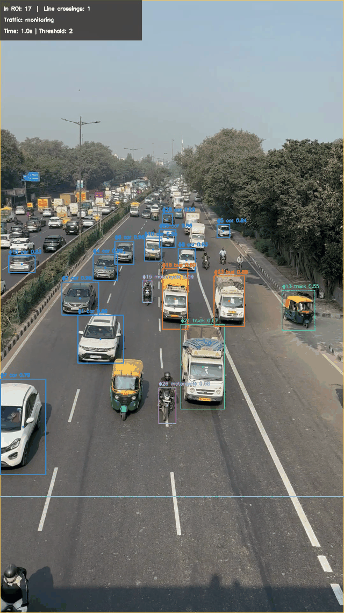
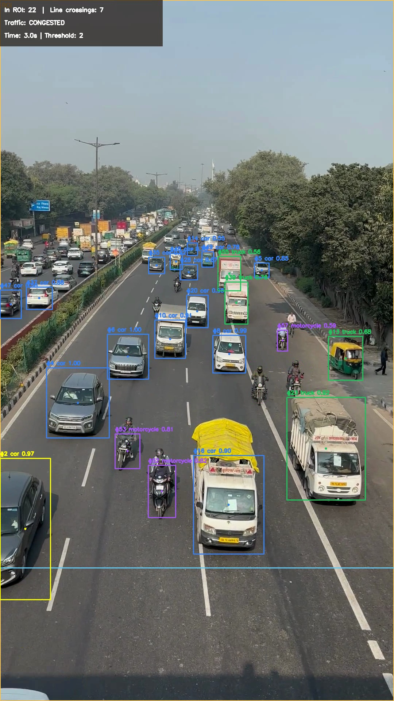
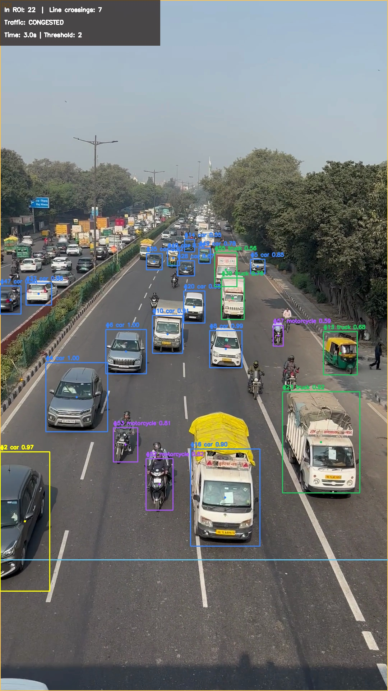

## RoadWatch Demo

### Annotated vehicle tracking and counting

### Vehicle detection and tracking

### Congestion detection evidence

### Twilio SMS alert preview

The application successfully submitted a congestion alert
to Twilio. Carrier delivery was blocked with error 30034
(unregistered US A2P 10DLC sender). The image above is
an illustrative alert preview, not a delivered SMS screenshot.
